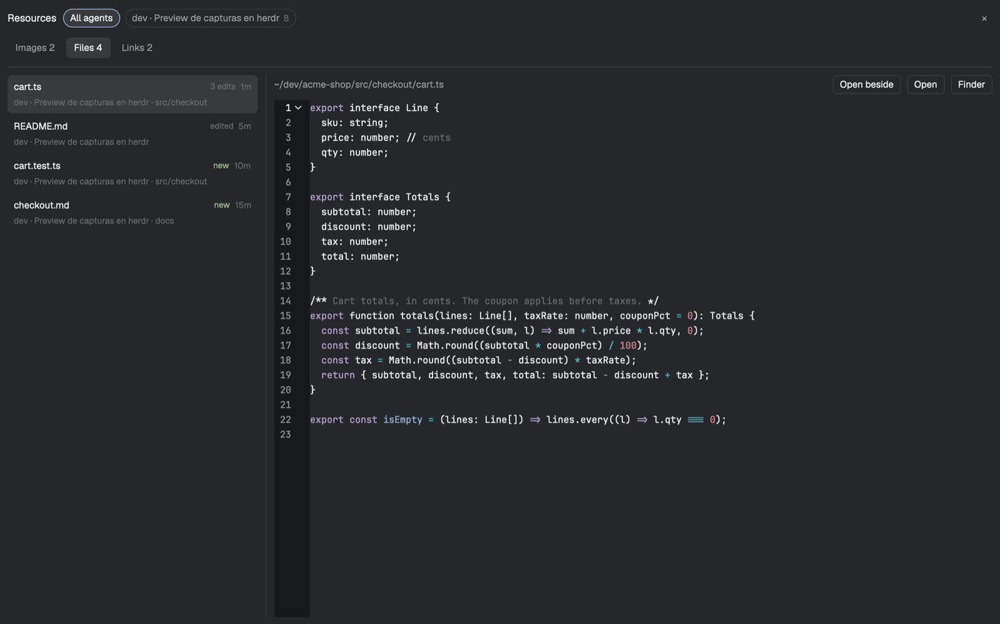

# Shot preview

See what each Claude Code agent produces without leaving Herdr. A small card pops up in the
corner whenever an agent takes a screenshot or reads an image. A Resources panel lists, per
agent, the images it captured, the files it wrote or edited (with a live preview) and the pages
it published: PRs, issues, artifacts, Jira tickets.

Two mods (`shot-preview`, `resources-pane`), a `keys.json` and a Claude Code `PostToolUse` hook
that feeds them, shipped inside `shot-preview`. The hook is required: without it the mods have
nothing to show, and it has to be added to Claude Code's settings by hand.

## What you see

- **Card**: a floating block on the `work` column, bottom right (`edge: "right"`,
  `align: "end"`), 300px wide, `px 8` / `py 4`, text 11.5px. Hidden (an empty `div`) until an
  image arrives. Top: the image, aspect kept, at most 300×200, never upscaled, rounded 4. Below
  it, one row:
  - who took it: `space · tab` (or the terminal title without its leading status glyph), else
    the folder with `~`; `t.foreground`, truncated;
  - `+N` when more images came in while it was up (chip, `t.selected` background, `t.muted` text);
  - how long ago (`now`, `42s`, `5m`, `3h`, `2d`) in `t.dim`;
  - `↗` (open in Preview) and `×` (hide), 20×20 icon buttons, `t.muted`, `t.hover` on hover.

  The image's tooltip has the original path, the tool (`playwright · browser_take_screenshot`)
  and the size.
- **Resources panel**: a dialog, 0.85 × 0.85 of the window, `t.popover` background, `p 12`, text 12px.
  - Header, 28px: "Resources" (semibold, 13px), then the agent chips in a row that scrolls
    sideways, then `×`. Chips are 24px high and fully rounded, with a 1px border: "All agents",
    then up to 8 agents, most recent first, each with its label and a count (images + files +
    links, 11px, `t.dim`). An agent whose terminal is gone shows its folder's name and
    "(closed)". The selected chip has a `t.accent` border and a `t.selected` background.
  - Tab row, 28px: "Images N", "Files N", "Links N" (26px high, rounded 6, the active one
    `t.selected` and medium weight), and on the right "Go to agent" when one live agent is
    selected. Then a 1px `t.border` rule.
  - **Images**: the original path (`t.muted`) with Open and Finder buttons; the selected image as
    large as fits, centered; a meta line (who · tool · size · ago, `t.dim`); a strip of 96×64
    thumbnails that scrolls sideways, the selected one with a 2px `t.accent` border.
  - **Files**: a 320px list on the left, scrolling. Each row has the file name, a badge (`new` in
    `t.ansi2`, `edited`, or `N edits` in `t.dim`) and how long ago. Under it, the folder relative
    to the agent's cwd, with the agent label first when "All agents" is selected. The selected
    row is `t.selected`. Then a 1px divider, and on the right the path with Open beside, Open
    and Finder, over a read-only preview: Markdown rendered (`TextView.markdown`); other text in
    a read-only `Editor` with syntax colors from the theme (keyword `ansi5`, string `ansi2`,
    comment `dim`, function `ansi4`, type `ansi3`, number `ansi1`, constant `ansi6`) and the
    terminal font at 12px.
  - **Links**: one row per URL. A 64px kind label in `t.accent` (PR, Issue, Artifact, Jira, Doc,
    Release, Gist, Link), then the title (or the URL), a second line with the agent and URL in
    `t.dim`, and how long ago.
  - Empty tabs say what will show up there, centered, in `t.dim`.
- **File pane**: a pane (made by Open beside) with the file's path, Open and Finder, over the
  same preview, on `t.background`.
- **Pane header**: Herdr's shipped `pane` header plus one 14px layers icon (`resources.svg`,
  three stacked rhombi), `t.dim` with `t.hover` on hover. It shows on hover, only on agent
  panes, just before the split, zoom and close buttons.

## How it behaves

- A new image (not the ones already there when the card loads) pops the card up for 10s. A
  burst of images replaces it and counts up `+N`. While the pointer is on the card it stays,
  checking again every 1.5s. `×` hides it at once.
- On the card: click the image to open the Resources panel on that agent's Images tab with that
  image selected; click the label to focus the agent (`agent.focus`); `↗` opens the copy in the
  default app (`open`).
- The panel opens on the agent given (from the card or the pane header), else the focused
  terminal, else "All agents" when that agent produced nothing. The tab is the one asked for,
  else the first one that isn't empty. Clicking a chip switches agents and picks the tab again.
- Keys (the panel takes focus when it opens): `1` `2` `3` switch tabs, `Esc` closes.
  - Images: `←` newer, `→` older, `Enter` opens it.
  - Files: `↑` `↓` move, `Enter` = Open beside.
  - Links: `↑` `↓` move, `Enter` opens it in the browser.

  Clicking a link opens it.
- Everything is live: the panel and card re-read the feeds when the folder changes. The Files
  preview reloads when the agent touches the selected file again; the file pane reloads when the
  file changes on disk.
- Open beside closes the panel and runs `pane.split` (direction `right`) on the agent's pane
  (the focused one if the agent is gone) with this mod and `props: { file }`.
- Agent status (working, blocked, done, idle) doesn't change the card or the panel. The pane
  header keeps the shipped one's status marks.

## Built from

- **The hook** (`mods/shot-preview/hook/shot-preview.mjs` + `capture.js`, Node, standard
  library only; inside the mod so installing it installs the hook), registered in
  `~/.claude/settings.json` as a `PostToolUse` command hook,
  `node ~/.config/herdr-app/mods/shot-preview/hook/shot-preview.mjs`, matcher
  `Read|Bash|Write|Edit|NotebookEdit|Artifact|mcp__.*`, timeout 10. It reads the hook JSON on
  stdin and writes into `<appHome>/shot-preview/`, where `appHome` is `$HERDR_APP_HOME` or
  `~/.config/herdr-app`. It does nothing if that folder doesn't exist.
  - Images: an image file `Read` read; image paths (quoted or bare, `.png` `.jpg` `.jpeg`
    `.gif` `.webp`) in a `Bash` command or its stdout, and absolute ones in an `mcp__*` tool's
    text, if written in the last 2 minutes; base64 images an MCP tool returned
    (`{type:"image", data, mimeType}` or `{type:"image", source:{data, media_type}}`).
    - At most 6 per call and 25 MB each.
    - Each is copied as `YYYYMMDD-HHMMSS-mmm-<6 hex>.<ext>` and appended to `feed.jsonl` as
      `{name, key, src, tool, session, terminal, cwd, at, w, h}`. `w` and `h` are read from the
      PNG/GIF/WebP/JPEG header.
    - `key` (`realpath:mtime:size`, or the sha1 for inline images) dedupes, so a file that `Bash`
      wrote and `Read` then looked at counts once.
    - The newest 30 are kept, and older copies are deleted.
  - Files: `Write` (`create` when `tool_response.type` is `create`, else `edit`), `Edit`,
    `MultiEdit`, `NotebookEdit`; not under `/tmp`, `/private/tmp` or `/var/folders`.
  - Links:
    - the first URL `gh`/`glab` `pr|mr|issue|release|gist|repo create` prints (not
      `/pull/new/`), titled from `--title`/`-t`;
    - an `Artifact` publish's claude.ai URL, titled from its `title` or the file name;
    - for `mcp__*` tools whose last segment matches `create|publish`, the first URL that isn't
      `/rest/`, `/api/` or `/gateway/`; else a Jira key becomes `<origin>/browse/<KEY>`.

    The kind (pr, issue, artifact, jira, doc, release, gist, link) comes from the URL.
  - Lines go to `resources.jsonl` as `{kind:"file", path, op}` or `{kind:"link", url, type,
    title}`, plus `tool, session, terminal, cwd, at`. The newest 1000 lines are kept.
  - Both feeds are trimmed by rewriting them atomically (temp file + rename) once they are 10%
    over the cap.
  - `terminal` is `$HC_TERMINAL_ID`, which Herdr sets in each terminal and which equals the
    agent's `address`.
- **`mods/shot-preview`** (`mod.json`: `place: "none"`, an `overlay` dialog 0.85 × 0.85). One
  `View` with three roles, picked from `props()`:
  - no props: the card (as the layout's floating block);
  - `overlay` set: the panel, with optional props `terminal`, `tab`, `name`;
  - `file`: the file pane.

  It uses:
  - `watchFolder` on `<appHome>/shot-preview` (created with `fs.mkdir` first), `readTextFile`,
    `image("shot-preview/<name>")` (a path relative to `appHome`);
  - `agents()` for the labels and panes, `focused()`, `placement()?.hovered` for the card;
  - `openOverlay`, `closeOverlay(props().overlay)`, `run("agent.focus")`, `run("pane.split")`;
  - `exec("open", …)` for Open, Finder (`-R`) and the browser, with a `notify` toast when it
    fails;
  - from gpui-base: `Editor` / `EditorState` and `TextView.markdown`.

  The files are `main.js` (reads the feeds and picks the role), `card.js`, `panel.js`,
  `viewer.js`, `ui.js`, `logic.js` (pure functions with no imports) and `hook/`, which the mod
  never loads.
- **`mods/resources-pane`**: a copy of Herdr's shipped `mods/pane` (Apache-2.0) with a
  `resources` button that calls
  `openOverlay({mod: "shot-preview", props: {terminal}, kind: "dialog", width: 0.85, height: 0.85})`.
  It still loads its other icons from `mods/pane/*.svg`.
- **Layout** (yours, a clone): the card as
  `"floating": [{ "id": "shot-preview", "content": { "mod": "shot-preview" }, "edge": "right", "align": "end" }]`
  on the `work` node; the header as `pane.header.content.mod: "resources-pane"`.
- **`keys.json`**: `global` → `cmd-shift-r`: `mod.open {name: "shot-preview"}`. `mod.open`
  passes no props, so the panel falls back to the focused agent.

## Watch out

- Herdr only loads images from inside its home, so the hook copies them. They live in
  `<appHome>/shot-preview/`, **not** under `mods/`: writing there reloads the mod, and a
  reinstall would wipe them.
- `h_flex` centers its children vertically. The Files tab needs `.items_stretch()` on the row
  and `.h_full()` on both columns, or the preview collapses into the middle.
- Don't name a method `close` on the View: it's the lifecycle hook (`async close(cx)`), where
  the `EditorState` is released.
- `watchFolder` reports a whole folder. The file pane watches the file's parent and reloads only
  when the changed paths include the file (or the folder itself).
- `readTextFile` stops at 1 MiB. Larger or binary files show a message instead of a preview.
- The hook must never fail or block a tool call: catch everything and exit 0
  (`SHOT_PREVIEW_DEBUG=1` prints the errors).
- MCP response formats vary. Jira detection assumes the response carries the issue key and an
  `https://<site>` URL.
- Only activity after the hook is installed shows up, and only from agents running inside
  Herdr have a `terminal`. Others are listed by folder.
- `herdr-app check` only covers the first render, where the card is empty.
- macOS only as written (`open`, `open -R`).

## Done when

- `herdr-app check` passes on both mods, and the layout has no `layout.error`.
- Piping `{"tool_name":"Read","tool_input":{"file_path":"<some .png>"},"cwd":"/tmp"}` into the
  hook (inside a Herdr terminal) adds a line to `feed.jsonl` and a copy next to it, and the card
  pops up with the image and that agent's label, then hides after 10s.
- Piping the same input twice adds nothing the second time.
- An agent that edits a file shows it in the panel's Files tab (`cmd-shift-r` on that agent),
  and editing it again updates the preview and the `N edits` badge.
- Open beside splits a pane next to the agent that follows the file as it changes.
- `gh pr create --title X` run by an agent shows up under Links as "PR · X" and opens in the
  browser.
- Hovering an agent pane's header shows the layers icon, which opens the panel on that agent.
